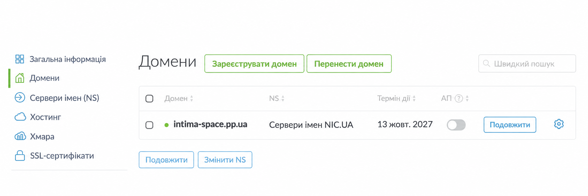
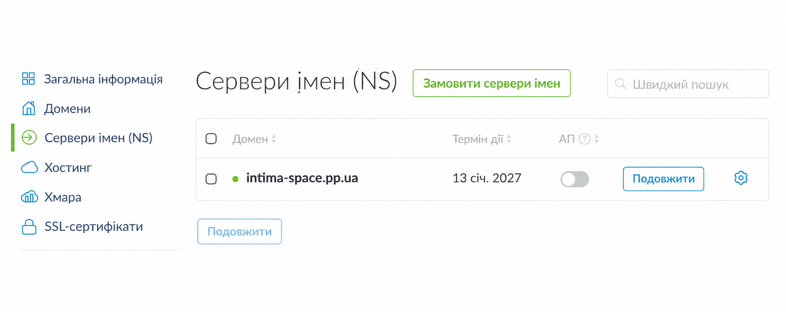

# Custom domain: Intima

## Addresses

- Production technical URL: https://intima-api.onrender.com
- Primary custom domain: https://intima-space.pp.ua

The React frontend and FastAPI API run together as one Render Web Service.
Neon remains the PostgreSQL database, while Gemini requests stay on the backend.

## DNS provider and nameservers

The domain is registered and its DNS zone is managed in NIC.UA.

- ns10.uadns.com
- ns11.uadns.com
- ns12.uadns.com

## DNS records

| Name | Type | Value | TTL |
| --- | --- | --- | --- |
| @ | A | 216.24.57.1 | 3600 |

The root-domain A record is the only DNS record used by the production
application. Existing mail and FTP records were left unchanged because they do
not affect the website.

## Render verification and HTTPS

Render Custom Domains reports:

- **Verified**
- **Certificate Issued**

Render manages and renews the TLS certificate for the primary domain. HTTP is
redirected to HTTPS by Render.

## Production smoke test

Checked on 2026-10-14:

~~~
GET https://intima-space.pp.ua/health
200 OK
{"status":"ok"}
~~~

The production dashboard loaded through the custom domain. The user also
manually verified that ledger data loads and changes in the dashboard are
reflected in Neon.

## Issue encountered and resolution

At first, Render displayed a message that it could not issue a certificate for
the custom domain and asked to check DNS records, especially `AAAA` and `CAA`.

The DNS zone was checked in NIC.UA:

- the root `@` record pointed to Render's required address `216.24.57.1`;
- no conflicting `AAAA` record was configured for the root domain;
- no restrictive `CAA` record was configured.

After DNS propagation, Render verified the primary domain and issued its
certificate. The final statuses are **Verified** and **Certificate Issued**.

## Screenshots for the submission

The safe screenshots kept in this repository show the NIC.UA domain and
nameserver pages without order numbers:

The lesson submission additionally includes safe screenshots showing:

1. the @ A record;
2. Render statuses **Verified** and **Certificate Issued**;
3. the Intima dashboard at https://intima-space.pp.ua.

Before publishing screenshots, hide email addresses, phone numbers, activation
codes, payment data, API keys, passwords, and any personally identifying
information.

## Free Render limitation

The production service does not depend on a local computer, but Render's Free
Web Service can spin down during inactivity. The first request after sleep can
take noticeably longer while the service starts again. A paid Render instance
is required for an always-awake service without this cold-start delay.
